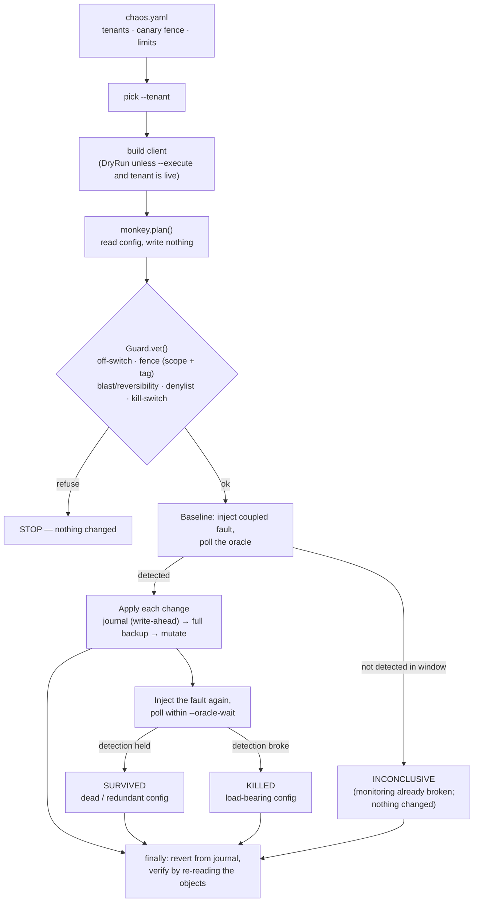
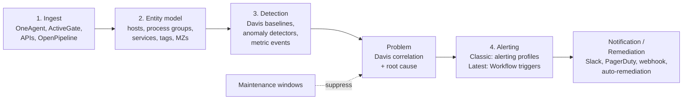

# Dynatrace Chaos Monkey 🐒

> **Chaos Monkey kills servers to prove your system survives. Dynatrace Chaos Monkey breaks your *monitoring* to prove you'd still find out.**

Status: **v0** — a working, reversible, canary-scoped engine (CLI + Swagger UI), plus the research foundation below.

> ⚠️ **This tool deliberately suppresses monitoring.** Run it only against a
> dedicated canary management zone, never production at large. It comes with **no
> warranty** ([LICENSE](LICENSE)); you are responsible for what it touches. Read
> [SAFETY.md](SAFETY.md) before running anything.
>
> *"Dynatrace" is a trademark of Dynatrace LLC. This is an independent, unofficial
> project — not affiliated with or endorsed by Dynatrace.*

- 🛟 Safety & threat model: [`SAFETY.md`](SAFETY.md)
- 📚 Full API catalog: [`docs/api-index.md`](docs/api-index.md)
- 🎯 Settings 2.0 target list: [`docs/settings-schemas.md`](docs/settings-schemas.md)
- 🔥 Destructiveness ranking: [`docs/destructiveness-index.md`](docs/destructiveness-index.md)

## The troop

Each monkey is one kind of chaos. The ones that **fire** are reversible and canary-scoped; the dangerous ones are **quarantined** — modeled and classified, but execution is hard-blocked by the guard.

| Monkey | Fires? | What it does |
|---|---|---|
| **Marmoset** | 🐒 | Disables a canary Davis anomaly detector |
| **Baboon** | 🐒 | Blinds a canary alerting profile (severity filter + delay) |
| **Ape** | 🐒 | Disables or deletes a canary problem notification |
| **Mandrill** | 🐒 | Leaves a TTL'd maintenance window over the canary scope |
| **Howler** | 🐒 | Creates a canary routing profile in an isolated MZ |
| **Capuchin** | 🐒 | Clears a canary auto-tag rule (entity loses its routing tag) |
| **Gibbon** | 🐒 | Sets a canary service's anomaly detectors to DONT_DETECT |
| **Langur** | 🐒 | Narrows a canary management zone so the entity falls out of it |
| **Colobus** | 🐒 | Excludes the canary log source from storage |
| **Saki** | 🐒 | Downgrades a canary *host* to infrastructure mode (MANUAL revert) |
| **Mangabey** | 🐒 | Redefines a canary failure-detection rule so 5xx count as success |
| **Gelada** | 🐒 | Lowers a canary SLO's target so it can never breach |
| **Tamarin** | 🐒 | Enables frequent-issue muting so a recurring canary problem goes quiet |
| **Loris** | 🐒 | Freezes OneAgent auto-update for the canary host group (version drift) |
| **Tarsier** | 🐒 | Revokes a dedicated canary ingest token (data silently stops) |
| **Vervet** | 🐒 | Disables a canary synthetic monitor (endpoint failure goes unseen) |
| **Potto** | 👁 | *Watcher*: probes a canary change, then asserts the audit log recorded it |
| **Gorilla** | 🔒 | *Mass monitoring-mode downgrade* — restart-to-recover, fleet-wide |
| **Kong** | 🔒 | *Tenant token rotation* — disconnects every OneAgent, no clean revert |
| **Leech** | 🔒 | *Bulk-DQL cost inflation* — unrefundable financial harm |
| **Locust** | 🔒 | *Unfiltered tenant-wide alert spam* — on-call noise weapon |
| **Reaper** | 🔒 | *Hard delete / bucket deletion / anonymization / agent uninstall* |

### Install

One step gets you both the `troop` CLI and the `troop-web` Swagger UI.

```bash
pipx install "dynatrace-chaos-troop[all]"   # isolated global install (recommended)
```

```bash
uv tool install "dynatrace-chaos-troop[all]"   # or, with uv
```

```bash
pip install -e ".[all]"   # or, from a clone, editable
```

Prefer not to install Python at all? One command serves the Swagger UI in a container:

```bash
docker run --rm -p 8077:8077 ghcr.io/OWNER/dynatrace-chaos-troop   # then open :8077/docs
```

> `[all]` = CLI + real Dynatrace HTTP client + Swagger UI. Use `[http]` or `[web]` for just one.
> On PyPI/GHCR the package isn't published yet; until then install from the clone (`.[all]`) or `docker build -t troop .`.

### Running it

Configure one or more tenants in `chaos.yaml` (copy [`chaos.example.yaml`](chaos.example.yaml)), then:

```bash
troop quickstart --tenant prod-canary                # the ordered path, with your next command spelled out
troop canary setup --tenant prod-canary --execute    # provision the canary fixtures a run needs
```

`troop quickstart` reads your config and prints the exact sequence from zero to your first verdict — which steps are done, and the precise command to run next. New here? Start with it.

`canary setup` creates a dedicated `chaos-canary-zone` management zone plus one tagged, zone-scoped object per event-drivable monkey (alerting profile, problem notification, Davis detector, auto-tag rule), writes a manifest of exactly what it made, and prints the `canary_scopes:` line to paste into `chaos.yaml`. This is what keeps a first run from coming back empty. `troop canary teardown --execute` removes precisely those objects again. Without `--execute` it is a dry-run preview.

```bash
troop verify   --tenant prod-canary     # prove each monkey's schema on YOUR tenant (read-only)
troop selftest --tenant prod-canary     # prove the live detectors actually FIRE (end-to-end smoke)
troop doctor   --tenant prod-canary     # preflight: is the setup safe to run?
troop list                              # the troop + which monkeys are LIVE vs GATED
troop plan baboon --scope <canary-zone-id>     # dry-run: what it would change
troop run  baboon --scope <canary-zone-id>     # still dry-run (no --execute)
troop run  baboon --scope <canary-zone-id> --execute --oracle-wait 600   # real
troop rampage --seed 7 --scope <canary-zone-id>                          # pick one at random (live-only)
troop report --md report.md --json report.json                          # mutation-score scorecard
troop watch potto --scope <canary-zone-id> --execute                     # is the change even recorded?
troop restore --execute                 # replay the journal, put everything back
```

`<canary-zone-id>` is the scope `troop canary setup` printed (and `troop canary status` re-prints).

**The fault driver — what makes a verdict real.** A monkey mutates config; the [fault driver](src/troop/driver.py) injects the fault that config is supposed to catch, so the oracle can see if it still does. Three fault kinds are injected over the Dynatrace ingest APIs, so **7 monkeys are live** with no extra setup: `EVENT` (events ingest → a problem opens: `baboon`, `ape`, `mandrill`, `howler`, `tamarin`), `METRIC` (metrics ingest → a metric event trips: `marmoset`), and `LOG` (logs ingest → a log event fires: `colobus`). You can also fire faults by hand: `troop drive --kind metric --scope <id> --count 10 --execute`.

Crucially, `canary setup` provisions the **matching detectors**, not just the mutation targets — a metric event watching `chaos.canary.fault` (the one `marmoset` disables) and a log event on `chaos-canary` (the one `colobus`'s exclusion is meant to blind). Without them a metric/log fault would land but nothing would watch for it, so the baseline could never fire. With them, the live monkeys genuinely open a problem.

**Prove the detectors fire before you trust a verdict — `troop selftest`.** A schema-valid detector can still fail to *trip*; only a live tenant tells you. `troop selftest` injects each live fault and checks a problem actually opened — the whole loop, end to end, mutating no config. `[ OK ]` per monkey means it works on your tenant; a `[FAIL]` points you at the detector or push cadence to tune (the known-good config and tuning guide is [`docs/detectors.md`](docs/detectors.md)). Run it once and "never run live" is retired.

The remaining **9 are gated**: 6 need `TRACE` — real request traffic against an OneAgent-monitored service (a synthetic signal can't move a response-time baseline or a failure rate), and 3 are out-of-band (a dead token, a frozen agent, a synthetic run). For the `TRACE` ones, run the **reference canary service** and let a run drive it for you:

```bash
python examples/canary_service.py --port 8099                 # a service you can break on command (run under OneAgent)
troop run gibbon --scope <id> --execute --oracle-wait 600 --drive-canary http://localhost:8099
```

`--drive-canary` generates real failing/slow traffic against the service for the duration of the run, so the baseline has something to detect. `troop list` labels every monkey `LIVE`/`GATED` and names its fault kind; `troop plan`/`run` warn before a gated monkey runs; `rampage` picks live-only unless you pass `--include-gated` — so you never burn a run wondering why it came back `INCONCLUSIVE`.

**The scorecard.** `troop run`/`rampage` append each verdict to a results file; `troop report` turns the campaign into the thing a team acts on — a **mutation score** (killed / decided) plus the list of dead-config candidates and load-bearing config, as Markdown and JSON. `--since 7d` scopes it to a window and `--trend` adds the score-by-day table (the number means more as a trend than a snapshot). A committed example (generated against the in-memory simulation, not a live tenant) is in [`examples/sample-report.md`](examples/sample-report.md).

**Prove the schemas on your tenant first.** Settings 2.0 object shapes vary by tenant and version, so several monkeys ship representative shapes marked "verify on tenant." `troop verify` checks every monkey's schema against your tenant's catalog and validate-only-submits the canary shapes (**it never writes**), so you know before you run which monkeys fit your tenant and which need a one-line tweak. The maintainers have not run this against a live Dynatrace tenant — `troop verify` is how you, with a tenant, get that proof.

**See the runs land in Dynatrace.** Every run drops `CUSTOM_INFO` timeline markers and a `chaos.run_id`-tagged fault; [`dashboards/chaos-canary.json`](dashboards/chaos-canary.json) (classic) plus the DQL in [`dashboards/README.md`](dashboards/README.md) (Latest) surface them so an operator watches the experiments, not just the CLI.

```bash
troop-web      # then open http://127.0.0.1:8077/docs  (Swagger UI, same engine)
PYTHONPATH=src python examples/demo.py        # full KILLED/SURVIVED loop, no tenant
PYTHONPATH=src python examples/watch_demo.py  # observable vs blind-spot, no tenant
```

**Fire monkeys** ask *"did detection survive the break?"* → **KILLED** (load-bearing), **SURVIVED** (dead config), or **INCONCLUSIVE** when the baseline never fired or the detection window elapsed — a run the tool can't decide is never quietly called SURVIVED. **Watchers** ask *"was the change even observable?"* → **OBSERVABLE** or **BLIND SPOT** — the direct test of the "recorded ≠ noticed" gap (see [`docs/monkey-lineup.md`](docs/monkey-lineup.md) §A).

Nothing touches a tenant without `--execute`, a configured canary fence, and a plan the guard approves. Detection has latency, so set `--oracle-wait` to your Davis window; a `0` wait on a real run is flagged as unreliable. Create a file named `.troop-stop` to halt and force a revert.

**The oracle only credits a problem that is actually ours and actually new.** A problem counts toward the verdict only if it carries this run's id, sits on the canary scope by *exact* management-zone match, or is chaos-tagged — a bare substring mention of the scope does not. Any problem already open at baseline, or one that opened before the fault was injected, is excluded from the post-mutation check, so a lingering problem can't masquerade as fresh detection and read as a false `SURVIVED`. When a run comes back `KILLED` but a baseline problem is still open, it says so: Dynatrace may have merged the re-injected fault into the existing problem, and you should verify before acting on it. This is a v0 oracle — honest about what it can and can't attribute, which matters more than being confident.

---

## Architecture: how one run works

Same engine behind the CLI and the Swagger UI. A run reads config, builds a plan without touching the tenant, clears the guard, proves the fault is detectable, mutates, re-checks, and always reverts:



The verdict is three-state on purpose: a run the tool **cannot** decide is `INCONCLUSIVE`, never silently `SURVIVED` — a false "safe to delete" is the one answer a monitoring-assurance tool must never give. The full list of safety invariants (the permanent off-switch, the two-key fence, journal, backups, TTL, least-privilege) lives in [`SAFETY.md`](SAFETY.md); `troop doctor` checks them before you run.

**Module map:** `cli.py` / `web.py` (two front doors) → `config.py` (tenants) → `monkeys/` (plan) → `safety.py` (Guard + fence + off-switch) → `runner.py` (baseline → apply → oracle → revert) → `resources.py` (apply/undo per resource kind) → `journal.py` + `backup.py` (durable undo) → `client.py` (DryRun / HTTP).

---

## 1. The problem

Classic chaos engineering targets the **system being observed**. Kill a pod and the dashboards turn red, so you can see the damage.

Nobody tests the **observer**. When Dynatrace configuration drifts, nothing turns red, because the thing that would turn red is the thing that broke. For example:

- a maintenance window that was never closed
- an alerting profile raised to "Availability only"
- a webhook whose URL was rotated
- an auto-tag rule that stopped matching new hosts

Monitoring failures share three properties:

| Property | App failure (Chaos Monkey) | Monitoring failure (this project) |
|---|---|---|
| Visible? | Yes, alerts fire | **No. Silent by design** |
| Self-heals? | Often (reschedule, failover) | **Never. Config stays broken** |
| Discovered when? | Within minutes | **During the next real outage** |

## 2. The idea: mutation testing for monitoring

Borrowed from mutation testing of code. Here the *config* is the code and a *known fault* is the test.

```
for each config element in scope:
    snapshot it
    MUTATE it            (disable, inflate a threshold, add a suppression...)
    INJECT a known fault (canary metric spike, synthetic error event)
    OBSERVE              (did a problem open? did a workflow or notification fire?)
    REVERT and verify the revert
```

| Outcome | Meaning | Action |
|---|---|---|
| 💀 **KILLED**: detection broke after the mutation | This config is **load-bearing** | Protect it: config-as-code, review, drift alerts |
| 🧟 **SURVIVED**: still detected after the mutation | This config is **dead or redundant**, *or* no fault exercises it | Delete it, or add a fault scenario |
| ❓ **INCONCLUSIVE**: baseline never fired, or the detection window elapsed | Can't decide — often the **monitoring is already broken** (baseline case) | 🚨 the baseline case is the most valuable finding of all |

The tool reports `INCONCLUSIVE` rather than ever collapsing "I couldn't tell" into `SURVIVED`. **Mutation score** = killed / (killed + survived). A low score means a lot of your config isn't actually doing anything.

> ⚠️ **Do not automate on a verdict yet.** This is a v0 oracle. A `KILLED` can be a false positive — Dynatrace may have *merged* the re-injected fault into the baseline problem, so detection was actually fine; the run says so when it happens, and the CLI, the `messages`, and the API's `caution` field all repeat it. Treat every verdict as a prompt for a human to review, **never** as a trigger for automated remediation, paging, or config deletion. Earn that automation later, once you trust the oracle on your tenant.

## 3. How Dynatrace works: the pipeline

Every alert travels this path. A break at any stage blinds every later stage.



**Classic vs Latest Dynatrace.** On the Gen3 platform ("Latest Dynatrace"), Dynatrace hides many classic settings schemas and replaces them ([source](https://docs.dynatrace.com/docs/dynatrace-api/environment-api/settings/removed-schemas)):

| Classic | Latest |
|---|---|
| `builtin:alerting.profile` + `builtin:problem.notifications` | **Workflows** (problem / Davis event / DQL triggers) |
| `builtin:anomaly-detection.metric-events` | `builtin:davis.anomaly-detectors` (DQL-based) |
| `builtin:management-zones` | **Segments** (filtering) + **IAM policies** (access) |
| `builtin:tags.auto-tagging` | removed |
| Log processing rules | **OpenPipeline** |

So the Chaos Monkey detects the generation first and loads the matching target set.

## 4. The API surface (summary)

Each API plays one of four roles in a chaos experiment. The full table with endpoints, scopes, blast radius and sources is in [`docs/api-index.md`](docs/api-index.md).

| Role | APIs |
|---|---|
| **MUTATE**: what we break | Settings 2.0 (`/api/v2/settings/objects`), Workflows (`/platform/automation/v1`), OpenPipeline (Settings schemas), tags, tokens, network zones, synthetic monitors, IAM policies |
| **INJECT**: how we create a known fault | Events ingest (`POST /api/v2/events/ingest`, types such as `ERROR_EVENT`, `CUSTOM_ALERT`, `AVAILABILITY_EVENT`), Metrics ingest (`POST /api/v2/metrics/ingest`, canary metric), logs and bizevents ingest, synthetic monitors pointed at a failing URL |
| **OBSERVE**: the oracle (did Dynatrace notice?) | Problems v2 (`/api/v2/problems`), Grail DQL (`dt.davis.problems`, `dt.davis.events`), workflow executions, a notification sink (a webhook receiver we own) |
| **GUARD**: safety | Settings object snapshots plus optimistic-locking update tokens, audit logs (`/api/v2/auditlogs`, Grail audit logs) |

API families covered: Environment API v2 (and surviving v1) · Configuration API v1 (legacy, mostly migrated to Settings) · Settings 2.0 · Platform APIs (Grail, AutomationEngine, OpenPipeline, Documents, AppEngine, SLO) · Account Management / IAM. The Cluster API (Managed) is out of scope.

## 5. What breaks Dynatrace

Grouped by pipeline stage. "Silent?" means nobody gets told it broke.

### Stage 1: Ingest (data never arrives)

| Break | Controlled by | Symptom | Silent? |
|---|---|---|---|
| Host switched from full-stack to infrastructure mode | `builtin:host.monitoring.mode` | Services, traces and response-time anomalies vanish; the host still looks "green" | ✅ Yes |
| Technology sensor disabled | `builtin:oneagent.features` | Java/.NET/Node services disappear | ✅ Yes |
| Process excluded from deep monitoring | `builtin:process.*-monitoring-rule` | Process visible, no service-level data | ✅ Yes |
| Network zone pointing at nothing | `builtin:networkzones`, remote config | Agents can't reach an ActiveGate, data stops | ⚠️ Partly (agents go offline) |
| Integration token expired or revoked | Tokens API | Metric pushes and log forwarders get 401s *at the sender* | ✅ Yes, inside Dynatrace |
| Log ingest rule excludes a source | `builtin:logmonitoring.log-storage-settings` | Log-based alerts never fire | ✅ Yes |
| OpenPipeline drop processor too broad | `builtin:openpipeline.*.pipelines` | Records dropped before storage | ✅ Yes |
| Ingest caps or overload prevention too low | `builtin:trace.ingest.control`, `builtin:rum.overload-prevention` | Data is sampled away | ✅ Yes |

### Stage 2: Entity model (data lands on the wrong thing)

| Break | Controlled by | Symptom | Silent? |
|---|---|---|---|
| Process group detection rule changed | `builtin:process-group.*-detection-rule` | PGs split or merge → **baselines reset**, history orphaned | ✅ Yes |
| Service detection or splitting changed | `builtin:service-detection-rules` | New service IDs → anomaly baselines relearn from zero | ✅ Yes |
| Auto-tag rule stops matching | `builtin:tags.auto-tagging` (Classic) | Entity loses `team:x` → routing filters miss it | ✅ Yes |
| Management zone rule narrowed | `builtin:management-zones` (Classic) | Entity drops out of the MZ the alerting profile filters on | ✅ Yes |

### Stage 3: Detection (Davis doesn't notice)

| Break | Controlled by | Symptom | Silent? |
|---|---|---|---|
| Custom detector disabled or threshold inflated | `builtin:davis.anomaly-detectors` / `metric-events` | No event raised | ✅ Yes |
| Built-in thresholds raised | `builtin:anomaly-detection.{services,infrastructure-hosts,rum-web,kubernetes.*}` | Real degradation stays under the bar | ✅ Yes |
| Failure detection redefined | `builtin:failure-detection.*` ⚠️ | 5xx counted as success → failure rate looks 0% | ✅ Yes |
| Frequent-issue detection muting a real recurring problem | `builtin:anomaly-detection.frequent-issues` (Classic) | Problem "known", not alerted | ✅ Yes |

### Stage 4: Alerting and notification (Davis knows, humans don't)

| Break | Controlled by | Symptom | Silent? |
|---|---|---|---|
| Maintenance window left active | `builtin:alerting.maintenance-window` | Problems suppressed | ✅ Yes |
| Alerting profile severity or delay raised | `builtin:alerting.profile` (Classic) | Problem opens in the UI, nobody is paged | ✅ Yes |
| Notification disabled or webhook URL broken | `builtin:problem.notifications` (Classic) | Delivery fails | ✅ Yes (failure only visible in the UI) |
| Workflow trigger too strict, disabled, or actor lost a permission | AutomationEngine + IAM (Latest) | No execution, or execution fails | ✅ Yes |

### Stage 5: Access and analysis

| Break | Controlled by | Symptom | Silent? |
|---|---|---|---|
| SLO target or metric changed | SLO API | SLO looks healthy while users suffer | ✅ Yes |
| IAM policy removed from a service user | Account Management API | Automation and integrations fail with permission errors | ✅ Mostly |

**Pattern:** almost every break is silent. That's the whole case for this project.

## 6. How Dynatrace breaks the systems it monitors

Dynatrace isn't passive. OneAgent lives *inside* your processes, so its config can hurt production directly. These risks are why the Chaos Monkey keeps OneAgent and RUM mutations behind 🔴 high-blast flags.

| Mechanism | How it hurts | Notes |
|---|---|---|
| **Code-module injection** | OneAgent injects into processes (for example through the dynamic loader on Linux). Enabling or changing deep monitoring needs a **process restart** to take effect. A full stop and start for Apache, not a graceful restart ([docs](https://docs.dynatrace.com/docs/ingest-from/dynatrace-oneagent/oneagent-troubleshooting/troubleshoot-oneagent-installation)). | Config looks applied but isn't, until the next restart. That drift is confusing. |
| **Agent version skew** | After a OneAgent update, running processes keep the old code module until they restart. | Mixed versions across a fleet. |
| **Kubernetes injection** | Classic full-stack deployments can show "container needs restart" on new nodes because of start-order races (community-reported). | Pods run unmonitored. |
| **Overhead** | Deep monitoring, extra sensors and request-attribute capture add CPU, memory and latency. | Turning *on* features is also a risk. |
| **RUM JavaScript injection** | Auto-injection can **break web pages**: CSP blocks the script, XHTML pages fail, a bad injection point, firewalls block the beacon, servlet edge cases ([community guide](https://community.dynatrace.com/t5/Troubleshooting/Resolve-issues-where-RUM-injection-is-breaking-a-web-application/ta-p/234580)). | Users see the breakage, not you. |
| **Automation and auto-remediation** | Workflows can restart services, scale, roll back or open tickets. A **false** problem triggers needless remediation. A **missed** problem means no remediation. | The monitoring config *drives* actions in production. |
| **Data capture and compliance** | Request attributes, log capture and session replay can collect PII if masking is misconfigured. | The break is legal, not technical. On the denylist. |
| **Cost** | Ingest volume (logs, spans, events) costs DPS/DDU. A bad pipeline or capture rule can blow a budget. | Event ingest itself consumes DDUs ([docs](https://docs.dynatrace.com/docs/dynatrace-api/environment-api/events-v2/post-event)). |

## 7. Why it breaks

1. **Config sprawl.** Hundreds of settings objects across dozens of schemas, plus workflows, pipelines and policies. Nobody holds the whole graph in their head.
2. **Scope inheritance.** Settings resolve environment → host group → host/entity. A host-level override silently beats the environment default you just "fixed".
3. **Hidden coupling.** Alerting depends on tags, which depend on detection rules, which depend on process metadata. Change one rule and three stages later a page stops arriving.
4. **Silent by design.** Monitoring has no monitor. Changes rarely produce an error. They produce an *absence*.
5. **Never self-heals.** Infrastructure has controllers that reconcile state. Dynatrace config stays wrong until a human notices.
6. **ClickOps without review.** Most tenants are edited in the UI. Config-as-code (Monaco, Terraform) is the exception, and even then drift detection checks *sameness*, not *effectiveness*.
7. **Shared ownership.** Platform owns OneAgent, app teams own detectors, SRE owns workflows, security owns IAM. Changes collide at the boundaries.
8. **Platform migration.** Moving from Classic to Latest replaces whole families (alerting profiles → Workflows, MZs → Segments). Mappings get lost in translation.
9. **Temporary becomes permanent.** "Just mute it during the deploy." Maintenance windows, raised thresholds and disabled detectors outlive their reason.

## 8. Chaos experiment catalog (v0)

Each experiment = **one mutation + one injected fault + one expected signal**. Fault injectors use a dedicated canary (metric `chaos.canary.*` or events tagged `chaos=true`) so a real incident is never confused with an experiment.

| # | Experiment | Target (schema / API) | Mutation | Fault to inject | Expected signal (baseline) | Silent? | Blast | Gen |
|---|---|---|---|---|---|---|---|---|
| E01 | Detector off | `builtin:davis.anomaly-detectors` | `enabled=false` | Canary metric over threshold | Davis event + problem | ✅ | 🟢 | L |
| E02 | Threshold inflation | `builtin:davis.anomaly-detectors` / `metric-events` | threshold ×10 | Canary metric over the original threshold | Problem | ✅ | 🟢 | C+L |
| E03 | Condition flip | same | `ABOVE` ↔ `BELOW` | Canary spike | Problem | ✅ | 🟢 | C+L |
| E04 | Sluggish detector | same | `violatingSamples` → 60 | Short canary spike (5 min) | Problem | ✅ | 🟢 | C+L |
| E05 | Zombie maintenance window | `builtin:alerting.maintenance-window` | Insert an active window over the canary scope | `ERROR_EVENT` on the canary entity | Problem *and* notification | ✅ | 🟡 | C+L |
| E06 | Severity filter | `builtin:alerting.profile` | Minimum severity → `AVAILABILITY` | `ERROR_EVENT` | Notification | ✅ | 🟡 | C |
| E07 | Delayed alerting | `builtin:alerting.profile` | Delay → 60 min | `ERROR_EVENT` | Notification within the SLA | ✅ | 🟡 | C |
| E08 | Dead webhook | `builtin:problem.notifications` | URL → unroutable | `ERROR_EVENT` | Sink receives the payload | ✅ | 🟡 | C |
| E09 | Notification off | `builtin:problem.notifications` | `enabled=false` | `ERROR_EVENT` | Sink receives the payload | ✅ | 🟡 | C |
| E10 | Workflow trigger too strict | AutomationEngine workflow | Minimum severity raised / matcher broken | `ERROR_EVENT` | Workflow execution + sink | ✅ | 🟡 | L |
| E11 | Workflow actor loses permission | IAM policy (Account API) | Remove `storage:events:read` from the canary service user | `ERROR_EVENT` | Execution succeeds | ✅ | 🔴 | L |
| E12 | Tag drift | `builtin:tags.auto-tagging` | Invert the condition for the canary entity | `ERROR_EVENT` | Routed notification | ✅ | 🟡 | C |
| E13 | Zone drift | `builtin:management-zones` | Narrow the rule to exclude the canary entity | `ERROR_EVENT` | MZ-filtered notification | ✅ | 🟡 | C |
| E14 | Pipeline black hole | `builtin:openpipeline.*.pipelines` | Drop processor matching `chaos=true` | Canary log or event | Record stored + alert | ✅ | 🔴 | L |
| E15 | Log ingest exclusion | `builtin:logmonitoring.log-storage-settings` | Exclude the canary log source | Canary log line | Log alert | ✅ | 🟡 | C+L |
| E16 | Integration token death | Tokens API | Revoke the *canary* ingest token | Push the canary metric with that token | Ingest succeeds (sender sees 401) | ✅ | 🟢 (canary token) | C+L |
| E17 | Synthetic blindness | Synthetic API | Disable the canary monitor / move it to an unused location | Canary URL returns 500 | Synthetic problem | ✅ | 🟢 | C+L |
| E18 | Service threshold raise | `builtin:anomaly-detection.services` | Raise response time and failure thresholds | Load generator against the canary service | Slowdown / failure problem | ✅ | 🟡 | C+L |
| E19 | Monitoring-mode downgrade | `builtin:host.monitoring.mode` | Full-stack → infrastructure on a **canary host** | Canary service error | Service problem | ✅ | 🔴 | C+L |
| E20 | Failure redefinition | `builtin:failure-detection.*` ⚠️ | Treat 5xx as success | Canary service returns 5xx | Failure-rate problem | ✅ | 🟡 | C+L |
| E21 | SLO goalpost move | SLO API (classic / platform) | Lower the target or swap the metric on the canary SLO | Canary error burst | SLO status turns red / burn-rate alert | ✅ | 🟢 | C+L |

Every stage in §5 maps to at least one experiment. Deliberately excluded: tenant token rotation, anonymization, bucket deletion, privacy and masking settings, OneAgent uninstall.

## 9. Safety principles (non-negotiable for the build)

1. **Dry-run by default.** `plan` lists mutants. Nothing changes without `--execute`.
2. **Canary-first.** Experiments target dedicated canary entities, metrics, tokens and hosts. Real config is opt-in per schema.
3. **Schema allowlist + hard denylist.** See [`docs/settings-schemas.md`](docs/settings-schemas.md#hard-denylist-never-mutated-under-any-flag).
4. **Scope fence.** Only objects tagged or scoped for chaos (a canary segment, MZ or host group) are touched.
5. **One mutant at a time.** Never stack mutations.
6. **Snapshot + write-ahead journal.** Every object is saved before changes. `restore` replays the journal after a crash.
7. **TTL auto-revert.** Every mutation carries a deadline and is reverted even if the run dies.
8. **Revert verification.** Re-read and diff after every revert. Abort the run if anything differs.
9. **Kill switch.** A single flag or file stops everything and restores immediately.
10. **Audit trail.** Every action is tagged (`chaos-monkey` in the object summary) and cross-checked against Dynatrace audit logs.
11. **Baseline gate.** If the fault isn't detected *before* a mutation, stop and report. Don't mutate monitoring that's already broken.

## 10. Roadmap

| Phase | Deliverable |
|---|---|
| **1. Research** ✅ | This README, the API index, the schema target list |
| **2. Mock tenant** | Fake Dynatrace (Settings, Events, Metrics, Problems, Workflows) with a mini detection pipeline. Lets us build without a tenant. Also generates `api-index.md` from a live schema dump. |
| **3. Engine + CLI** | Mutators per schema, fault injectors, oracles, journal and restore. `chaos-monkey plan | run | restore | report` |
| **4. Real tenant** | Dynatrace trial tenant (Classic and Latest), canary setup script, first real mutation score |
| **5. Game-day mode** | Random, unannounced mutations with time-to-notice scoring (the original "Chaos Monkey" spirit) |

## Open questions / to verify on a tenant

- Exact paths marked ⚠️ in [`docs/api-index.md`](docs/api-index.md) (tokens, Problems, AutomationEngine, Grail query, Account API).
- Which `eventType` values open a problem by default, and how fast (the docs only say "problem-opening events" behave differently).
- How often Davis anomaly detectors evaluate, which sets the minimum experiment duration.
- `builtin:failure-detection.*` schema IDs and the maintenance-window schema name in Latest.
- Whether a classic API token can reach Workflows, or whether OAuth/platform tokens are needed everywhere in Latest.

## References

- [Dynatrace API overview](https://docs.dynatrace.com/docs/dynatrace-api) · [Environment API](https://docs.dynatrace.com/docs/dynatrace-api/environment-api) · [Settings API](https://docs.dynatrace.com/docs/dynatrace-api/environment-api/settings) · [Schema list](https://docs.dynatrace.com/docs/dynatrace-api/environment-api/settings/schemas) · [Removed schemas (Classic → Latest)](https://docs.dynatrace.com/docs/dynatrace-api/environment-api/settings/removed-schemas)
- [Deprecations and migration guides](https://docs.dynatrace.com/docs/dynatrace-api/basics/deprecation-migration-guides) · [Maintenance windows → Settings](https://docs.dynatrace.com/docs/dynatrace-api/basics/deprecation-migration-guides/maintenance-windows-to-settings)
- [Events ingest](https://docs.dynatrace.com/docs/dynatrace-api/environment-api/events-v2/post-event) · [Metrics ingest](https://docs.dynatrace.com/docs/dynatrace-api/environment-api/metric-v2/post-ingest-metrics) · [Problems v2](https://docs.dynatrace.com/docs/dynatrace-api/environment-api/problems-v2) · [Tokens](https://docs.dynatrace.com/docs/dynatrace-api/environment-api/tokens-v2)
- [Davis anomaly detectors via API](https://docs.dynatrace.com/docs/dynatrace-intelligence/anomaly-detection/set-up-anomaly-detectors-via-api) · [Workflow event triggers](https://docs.dynatrace.com/docs/analyze-explore-automate/workflows/trigger/event-trigger) · [OpenPipeline configuration API (deprecated)](https://docs.dynatrace.com/docs/platform/openpipeline/reference/openpipeline-api/configurations-api/get-configuration)
- [Platform services](https://developer.dynatrace.com/develop/platform-services/services/) · [Account Management API](https://docs.dynatrace.com/docs/dynatrace-api/account-management-api)
- [OneAgent installation troubleshooting](https://docs.dynatrace.com/docs/ingest-from/dynatrace-oneagent/oneagent-troubleshooting/troubleshoot-oneagent-installation) · [RUM injection breaking web apps (community)](https://community.dynatrace.com/t5/Troubleshooting/Resolve-issues-where-RUM-injection-is-breaking-a-web-application/ta-p/234580)

---

*Not affiliated with Dynatrace or Netflix. "Chaos Monkey" is used as a nod to Netflix's original tool.*
